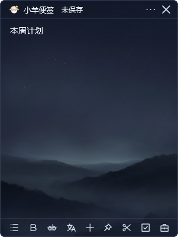
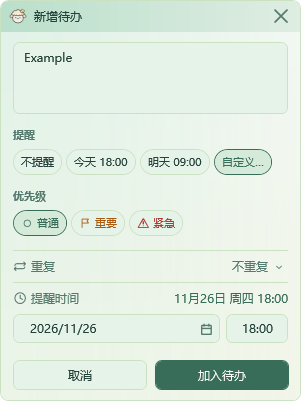
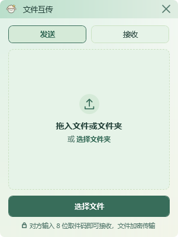

# 小羊便签 · KimNotes

小羊便签是 Windows 桌面便签，内置截图贴图、待办提醒和文件互传。便签和待办可以离线使用，登录后可在多台电脑间同步。

**正式版 1.4.24** · [官网下载 ZIP](https://note.kimlulu.com/downloads/KimNotes-v1.4.24.zip) · [GitHub Releases](https://github.com/kimlonger/KimNotes/releases/latest) · [官网](https://note.kimlulu.com/)

| 桌面便签 | 待办提醒 | 文件互传 |
|:---:|:---:|:---:|
|  |  |  |

## 功能

- **桌面便签** 支持富文本、插图和滚轮缩放图片。便签会自动保存，每张都可单独选主题、置顶或贴边收起。可在便签列表中全文搜索。
- **截图与贴图** 框选后可用矩形、箭头、画笔、文字和马赛克标注。确认截图后会复制到剪贴板，也可以把截图贴在桌面或插入便签。文字识别结果可直接粘贴。
- **待办提醒** 可从便签选中文字新建待办，设定优先级和提醒时间，支持每天、工作日或每周重复。
- **文件互传** 在便签底部的工具箱里打开文件互传，用 8 位取件码加密直传文件或文件夹，支持后台传输和后台接收。
- **账号同步** 登录后可同步便签、图片和待办，也可以恢复已同步便签的历史版本。网页版支持查看同步内容和编辑普通便签。开启无痕模式后会暂停同步。

## 开始使用

支持 Windows 10 和 Windows 11，需要 .NET Framework 4.8。

1. 下载 ZIP，解压到一个文件夹，再双击 `KimNotes.exe`。
2. 关闭便签窗口后，程序仍在系统托盘运行。右键托盘图标可新建便签、打开列表、查看待办或进入设置。

从旧版升级时，先从托盘退出旧版，再用完整解压后的文件覆盖原程序目录。备份方法见 [数据维护说明](docs/development.md#数据存放与备份)。

### 默认快捷键

| 操作 | 快捷键 |
| --- | --- |
| 快速截屏 | `Ctrl + F1` |
| 打开最近便签 | `Ctrl + N` |
| 唤回贴图 | `Ctrl + F2` |
| 上一张 / 下一张贴图 | `Ctrl + ←` / `Ctrl + →` |

可以在设置中更改快捷键。

## 从源码构建

`master` 是 WPF 主分支，使用 C#、WPF 和 .NET Framework 4.8。旧版 WinForms 源码见 [`winform` 分支](https://github.com/kimlonger/KimNotes/tree/winform)。

准备 Visual Studio 2019 或 2022、.NET Framework 4.8 目标包及 NuGet CLI，然后在仓库根目录打开 Visual Studio 开发者命令提示符。

```powershell
nuget restore KimNotes.sln
msbuild desktop\KimNotes.Windows\KimNotes.Windows.csproj /p:Configuration=Release
```

联网功能的本地配置、测试和备份步骤见 [开发与数据维护](docs/development.md)。

## 反馈与许可

[GitHub Issues](https://github.com/kimlonger/KimNotes/issues) · [LINUX DO 社区](https://linux.do) · [Apache License 2.0](LICENSE)
