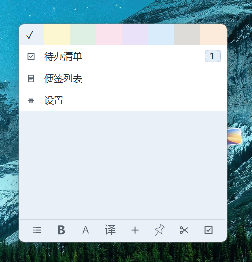
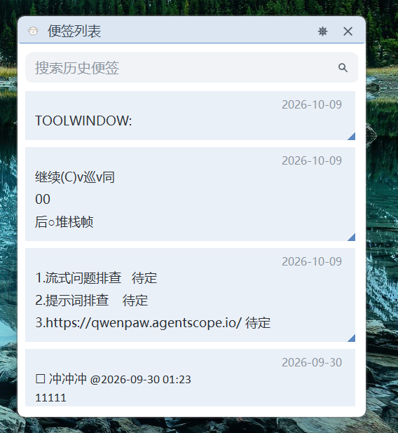
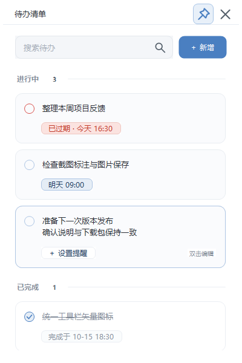
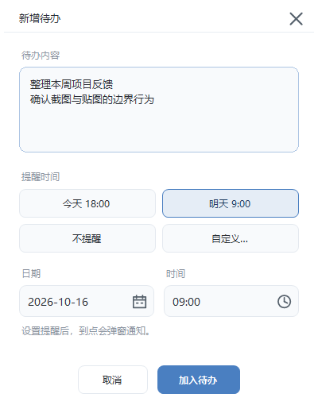
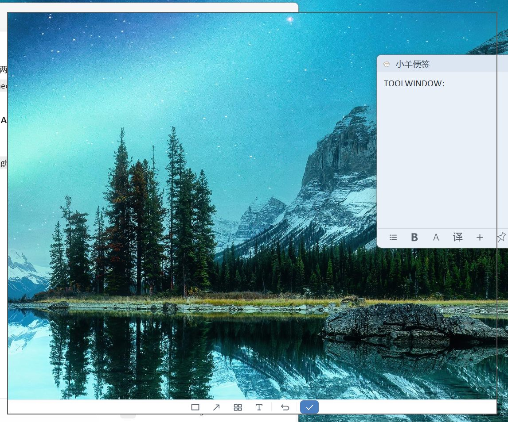

# 小羊便签 KimNotes｜Windows 桌面便签、截图贴图与待办提醒

免费开源的 Windows 10 / 11 桌面便签软件，集成截图标注、置顶贴图、OCR 图片文字识别、中英翻译和待办清单。解压即用、免安装、无需账号；便签与待办保存在本机，主动使用 OCR / 翻译时才将相关图片或文字发送至百度。

**最新版本 v1.4.10 · 2026-10-19**：[下载 Windows 版 ZIP](https://github.com/kimlonger/KimNotes/releases/download/v1.4.10/KimNotes-v1.4.10.zip) · [更新说明与全部版本](https://github.com/kimlonger/KimNotes/releases)

**本次更新**：记住桌面布局、自动保存反馈、便签内图片操作、每天 / 工作日 / 每周重复提醒、贴图历史与快捷键回看；改进截图选区和单行工具栏，区分「关闭贴图」与「销毁贴图」，移除贴图右上角 ×，简化托盘菜单。

[官网](https://note.kimlulu.com) · [GitHub 源码](https://github.com/kimlonger/KimNotes) · [Gitee 源码](https://gitee.com/xiaoyangkim/KimNotes) · [Apache-2.0 许可证](LICENSE)

支持 Windows 10 / 11，需要 .NET Framework 4.8。下载后完整解压，双击 `KimNotes.exe` 运行，请保留同目录的 `KimNotes.exe.config` 和 `Newtonsoft.Json.dll`。升级前先从托盘退出旧版；正常升级会继续使用原有数据目录，建议保留便签备份。

| 使用场景 | 功能 |
|---|---|
| 桌面记事、随手记录 | 多张置顶便签、每张独立主题、自动保存反馈、桌面布局恢复 |
| 截图反馈、图片参考 | 区域截图、可调选区、矩形 / 箭头 / 马赛克 / 文字标注、贴图历史回看 |
| 图文笔记、图片转文字 | 截图插入已有便签、便签内图片缩放 / 另存、百度 OCR、中英翻译 |
| 工作计划、周期提醒 | 待办清单、日期时间选择、每天 / 工作日 / 每周提醒 |

## 界面一览

| 便签与主题菜单 | 便签列表 | 待办清单 | 新增待办 |
|---|---|---|---|
|  |  |  |  |

便签右上角的「⋯」菜单可选择该便签的主题色，也可打开待办清单、便签列表和设置。

## 主要功能

### 便签与独立主题

- 支持边缘拖拽缩放、窗口置顶、项目符号、加粗、大小写转换、翻译和转待办。
- 8 套主题色，每张便签独立选择、独立保存；重启后恢复各自配色，便签列表也显示对应颜色。
- 便签失焦且鼠标在区域外连续 5 秒后，标题栏和工具栏用约 0.7 秒渐隐；再次点击便签后渐显。鼠标移入或键盘切回不会自动展开，两栏的空间始终保留，正文位置不变。
- 便签列表支持全文搜索和预览高亮，保存后自动刷新。
- 支持 `Ctrl+V` 在光标处粘贴图片，图片随 RTF 保存。
- 新建便签始终为空白；应用启动时恢复上次仍打开的已保存便签，首次使用回退到最近便签。同一文件不会重复打开多个编辑窗口。
- 每张便签记住窗口位置、大小、所在屏幕和置顶状态；屏幕断开或工作区变化时将窗口限制在可见区域。
- 输入停顿约 1 秒后自动保存，连续输入时最长约 5 秒尝试保存；标题栏短暂显示「已保存」，保存失败保留正文并自动重试。仅移动 / 缩放窗口时单独写布局，不替换正文备份。
- 双击嵌入图片查看大图，右键可复制、另存、放大 / 缩小、适应便签宽度或删除单张图片，保留前后正文。

### 截图、贴图与标注

默认全局热键为 `Ctrl+F1`，也可在设置中修改为 `Ctrl+一个键`。框选后直接显示单行白色圆角工具栏，选区仍可移动或拖动边角调整。点击矩形、箭头、马赛克或文字进入标注；OCR、拾色、插入便签、复制和另存均直接显示。工具切换和复制期间保留原选区遮罩、工具栏和图片位置。绿色对勾统一为「复制并贴图」：自动合并已有标注，将图片复制到剪贴板，退出遮罩、收起工具栏并保留置顶贴图。回车 / 双击选区转为贴图并显示工具栏。贴图不叠加右上角关闭按钮；右键菜单中「显示工具栏」可重新展开工具栏。



| 操作 | 行为 |
|---|---|
| 插入便签 | 追加到最近打开且仍未关闭的便签正文底部；没有打开的便签时新建一张 |
| 复制 | 将图片复制到剪贴板 |
| 标注 | 矩形、箭头、马赛克、文字；`Ctrl+Z` 撤销，`Esc` 完成标注，对勾合并标注后复制并保留贴图 |
| OCR | 调用百度识别文字，将结果新建为一张便签并复制到剪贴板 |
| 另存 | 打开文件选择窗口，选择保存位置，支持 PNG / JPEG |
| 拾色 | 在当前截图内取色，将 HEX 复制到剪贴板，同时显示 RGB；`Esc` 取消拾色 |
| 重置 100% | 恢复原始显示比例 |
| 上一张 / 下一张 | 在同一个浮窗浏览相邻截图，也可使用左右方向键 |
| 关闭贴图 | 右键「关闭贴图」或点击工具栏关闭按钮，关闭浮窗并保留历史，可再次唤回 |
| 销毁贴图 | 右键「销毁贴图」删除该图片的历史缓存并关闭其浮窗，不能再唤回，不影响用户另存的图片 |

普通模式下，双击贴图会保存到设置中「图片」指定的目录并关闭；无痕模式下双击直接关闭。标注或拾色时，双击不会触发保存关闭。截图右键菜单保留上一张 / 下一张，唤回最近贴图通过托盘或快捷键操作。

托盘右键也提供「唤回最近贴图 / 上一张贴图 / 下一张贴图」。默认全局快捷键如下，均可在设置中点击键帽修改，退格 / Delete 可禁用贴图快捷键：

| 功能 | 默认全局快捷键 |
|---|---|
| 唤回最近贴图 | `Ctrl+F2` |
| 上一张（更早） | `Ctrl+←` |
| 下一张（更新） | `Ctrl+→` |

四项全局快捷键（含截图）统一为 Ctrl + 单键；设置时会检查功能之间是否重复。点击键帽后可直接按左右方向键，也可按 Ctrl+方向键，Ctrl 为固定组合键；Esc 取消录入，切换窗口也会取消并恢复全局快捷键。上一版 F3 / F4 默认值自动迁移到左右方向键，已有的其他自定义键位保留。

标注和拾色期间不切换图片。普通模式将截图历史保留在独立缓存中，重启后可唤回；写入缓存时保留最近 50 张，并控制缓存容量。不会清理用户自行另存的文件。无痕模式仅保留本次进程内的有限记录，不写截图历史。

截图选区覆盖虚拟桌面，支持负坐标显示器、反向框选和右键 / `Esc` 取消。大图进入标注时会缩小显示，为工具栏留出空间；缩放只影响显示，保存与插入仍保留原始分辨率。截图和便签工具栏采用统一的矢量图标。

### 待办与提醒

便签「⋯」菜单可打开待办清单，工具栏的「转待办」会将选中文字带入新增窗口，原文保留；没有选区时创建空白待办。

- 便签、便签列表与待办清单默认 336×448；设置默认 320×480，新增 / 编辑待办默认 320×420，按 DPI 缩放。设置和待办使用更小的字号、行高与留白，路径和快捷键字段等宽对齐。
- 清单使用浅色卡片、圆形完成标记与紧凑提醒标签；单击卡片完成 / 恢复，双击编辑。点击提醒标签只修改提醒时间。
- 提醒预设为两列两行：今天 18:00、明天 9:00、不提醒、自定义。内容输入区固定高度、无滚动条，底部按钮居中。
- 日期和时间支持直接输入、方向键调整、日历及可滚动的快捷时间列表，无效日期不能提交。
- 到点弹出置顶提醒，可在设置中选择「仅弹窗」或「弹窗+铃声」。长提醒正文可滚动，操作按钮保持可见。
- 待办与提醒记录单独保存；未修改提醒时间时，不会因编辑内容而重复弹出已经触发的提醒。
- 可选择不重复、每天、工作日（周一至周五）、每周（所选日期的星期）。完成重复待办会安排下一次，并保持系列有效；没有完成上一期也能收到下一期提醒。
- 重复提醒保持原定钟点，长时间休眠错过多期时合并为最近一期；启动、唤醒和解锁后主动检查，临近到点时缩短检查间隔。同一期去重记录随数据保存，旧提醒窗口不能完成已经更改提醒时间的任务。

### 翻译与联网说明

选择正文后点击翻译；没有选区时使用首行。中文翻译为英文，其他语言翻译为中文。

发行包内含作者提供的百度应用配置，用户可直接使用，设置页没有凭证入口。OCR 会向百度发送所选截图，翻译会发送相应文字；这些功能需要联网。

### 无痕模式

设置页开启后，不恢复上次便签，便签、独立配色、待办与提醒记录仅留在内存中。截图双击直接关闭；手动「另存」仍会写入用户选择的位置。应用设置仍会保存，OCR / 翻译仍会联网。

## v1.4.10 更新说明

- 记住已保存便签的打开状态、位置、大小、屏幕和置顶状态；加入自动保存成功 / 失败反馈和重试。
- 支持便签内图片查看、复制、另存、缩放、适应宽度和删除，保留周围正文。
- 提醒支持每天、工作日和每周循环；启动、唤醒、解锁后检查，合并错过的周期，避免同一期重复弹出。
- 支持唤回最近贴图、上一张 / 下一张回看；默认 `Ctrl+F2`、`Ctrl+←`、`Ctrl+→`，均可修改并检查冲突。
- 截图框选后显示单行工具栏，选区仍可移动、调整大小；绿色对勾统一为「复制并贴图」，已有标注会合并到图片。
- 修复截图首击工具闪烁、局部遮罩变暗，以及确认后访问已释放 `ScreenOverlay` 的异常；改进跨屏布局处理。
- 右键「关闭贴图」保留历史，可再次唤回；「销毁贴图」删除该图片的历史缓存与备份，不影响另存文件。贴图不再叠加右上角关闭按钮。
- 缩小设置、待办编辑和列表的默认尺寸，统一字号与字段宽度，托盘改为紧凑普通菜单。

**验证：Release 编译通过，330 项隔离回归检查通过。** 覆盖截图会话、快速确认与关闭、遮罩释放后的窗口重建、贴图销毁与历史保留、双屏菜单边界、布局恢复、快捷键录入、图片操作和重复提醒。实际长期挂机、更多显示器 / 输入法组合及百度在线接口仍需实机验证。

## 常见问题

**便签和待办能离线使用吗？** 可以，它们保存在本机，无需登录。OCR 图片转文字和翻译使用百度在线服务，需要联网。

**截图怎么插入已有便签？** 框选后点击工具栏「插入便签」，图片追加到最近打开且仍未关闭的便签正文底部；没有便签打开时才新建。也可 `Ctrl+V` 在光标处粘贴图片。

**关闭的贴图怎么找回来？** 使用 `Ctrl+F2` 或托盘「唤回最近贴图」；`Ctrl+←` / `Ctrl+→` 浏览历史。右键「销毁贴图」会删除当前历史记录，此操作后的图片无法再从历史唤回。

**支持每天或工作日提醒吗？** 支持。新增 / 编辑待办时选择日期、时间及重复方式，可选不重复、每天、工作日、每周。

**Windows sticky notes with screenshot pinning.** KimNotes is a free, open-source desktop notes app for Windows 10/11, with local notes, screenshot annotation, pinned image history, OCR, translation, to-do lists and recurring reminders. Download the portable ZIP from [GitHub Releases](https://github.com/kimlonger/KimNotes/releases/latest). OCR and translation use Baidu online services.

## 编译运行

技术栈：C# / .NET Framework 4.8 / WinForms，旧式 csproj 与 `packages.config`；第三方依赖为 Newtonsoft.Json 13.0.3。

1. 使用 Visual Studio 2019 / 2022 打开 `KimNotes.sln`，安装 .NET Framework 4.8 目标包并还原 NuGet 包。
2. 如需使用 OCR / 翻译，在项目根目录自行创建 `baidu-credentials.local.json`：

   ```json
   {
     "TRANSLATE_APP_ID": "你的翻译 App ID",
     "TRANSLATE_SECRET": "你的翻译密钥",
     "OCR_API_KEY": "你的 OCR API Key",
     "OCR_SECRET": "你的 OCR Secret Key"
   }
   ```

   此文件已被 Git 忽略，构建时嵌入应用，不在 ZIP 中单独分发。公开源码不包含服务密钥；未提供此文件仍可编译，OCR / 翻译不可用。

3. 按 F5 运行，或在 Visual Studio 开发者命令提示符中执行：

   ```powershell
   msbuild KimNotes.csproj -p:Configuration=Release
   ```

### 官网源码

官网源码位于 [`website/`](website/)，静态页面和图片在 `website/public/`，由 Cloudflare Worker 提供服务。安装 Node.js 与 npm 后，可在该目录执行 `npm ci`、`npm run dev`；有对应 Cloudflare 权限时执行 `npm run deploy` 发布。

## 数据存放与备份

默认数据目录为 `%AppData%\KimNotes\`，便签和截图目录可在设置中修改。

| 文件 / 目录 | 用途 |
|---|---|
| `config.txt` | 截图热键、默认应用主题、存储路径、开机启动、无痕模式和提醒方式 |
| `notes\` | 默认便签正文目录，RTF 格式 |
| `notes\*.rtf.meta.json` | 每张便签的主题配色，备份 / 迁移时需与正文一起保留 |
| `open-notes.json` | 上次打开的已保存便签列表 |
| `screenshot-history\` | 可唤回的最近截图缓存，独立于用户导出的图片 |
| `images\` | 默认截图保存目录 |
| `index.json` | 便签全文搜索索引 |
| `todos.json` | 待办清单 |
| `reminders-fired.json` | 提醒去重记录 |

正文、配置与 JSON 使用同目录临时文件原子替换，覆盖时保留上一份 `.bak`。数据损坏时可从有效备份恢复；没有有效备份时保留损坏文件。更换便签目录时复制正文与配色文件，原目录保留；目标中存在内容不同的同名文件时阻止切换。

无痕模式之外，清空已经保存的便签会正常保存空内容。请在手动迁移或清理数据前备份整个数据目录与自定义便签目录。

## 回归验证

```powershell
powershell -ExecutionPolicy Bypass -File tests\run.ps1
```

测试使用临时隔离目录，不读写真实用户便签、不调用百度接口、不更改开机启动设置。覆盖独立主题、空闲精简、图片保存与渲染、全文索引、截图会话和标注、提醒去重、日期时间输入、滚动与缩放、备份恢复、写入失败重试及无痕模式等场景。可通过 `KIMNOTES_DATA_DIR` 指定独立数据目录。

几何与渲染模拟不替代真实多屏混合 DPI、输入法、长期挂机及在线接口验证。

## 使用说明

- 关闭所有窗口后仍会常驻托盘。托盘右键可新建便签、打开便签列表 / 待办清单 / 设置，或退出程序；左键唤回已打开的便签，没有已打开便签时新建。
- Windows 11 可能将新托盘图标放入任务栏 `^` 溢出区，可自行拖至可见区域。

## 社区与许可证

项目在 [LINUX DO](https://linux.do) 社区分享、交流并听取反馈。

采用 [Apache License 2.0](LICENSE)，使用、修改与再分发请遵循许可证要求并保留版权声明。
