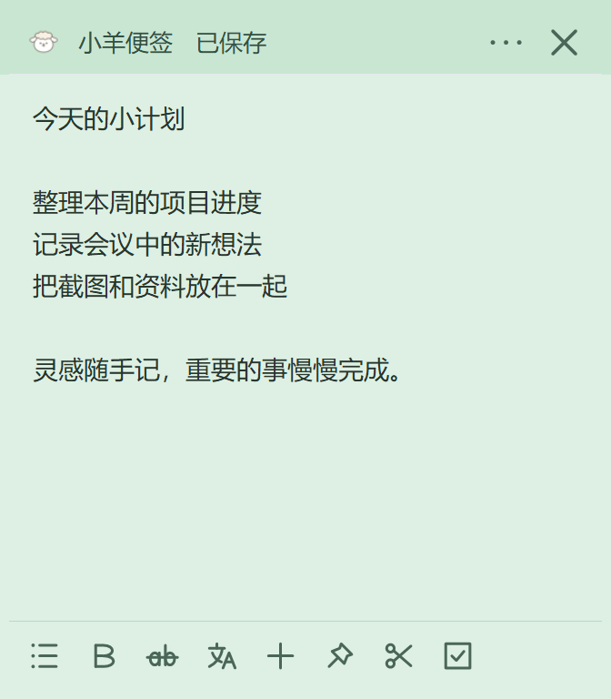
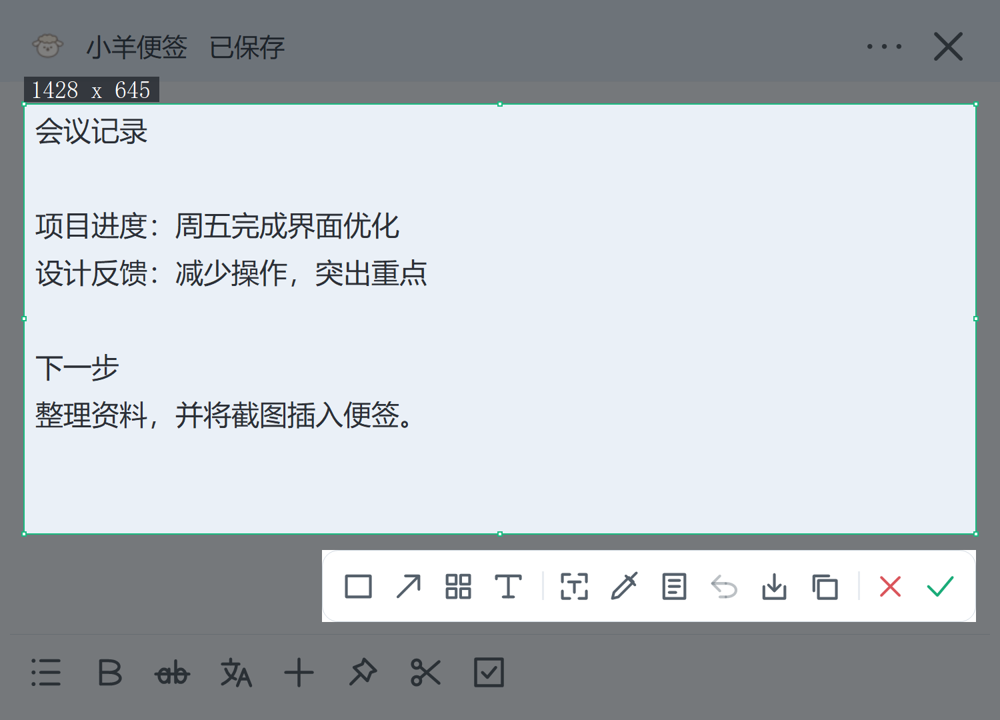
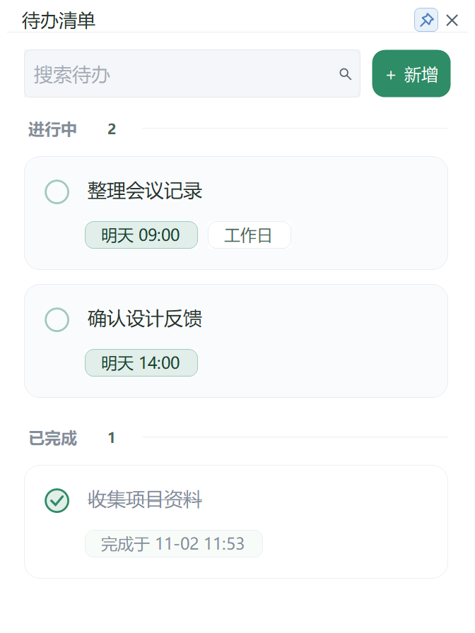

# 小羊便签 KimNotes

免费开源的 Windows 桌面便签：记录文字与图片、截图标注、贴图和待办提醒。支持本地使用，也可登录账号同步便签。

Free, open-source sticky notes for Windows with optional cloud sync, screenshot annotation, image pinning, OCR and reminders.

[官网](https://note.kimlulu.com/) · [下载 v1.4.18](https://note.kimlulu.com/downloads/KimNotes-v1.4.18.zip) · [GitHub Releases](https://github.com/kimlonger/KimNotes/releases) · [Gitee](https://gitee.com/xiaoyangkim/KimNotes)

| 桌面便签 | 截图与标注 | 待办提醒 |
|:---:|:---:|:---:|
|  |  |  |

## 功能

- **便签**：文字和图片、独立主题、置顶、自动保存与桌面布局记忆。
- **截图与贴图**：框选、标注、OCR、贴图，支持将截图插入便签和回看最近贴图。
- **待办**：支持每天、工作日和每周循环提醒。
- **云同步**：登录后自动同步便签和图片，新电脑登录后可下载；离线时先保存本机。
- **网页端**：查看、搜索和编辑普通便签，桌面富文本便签可查看。

## 开始使用

支持 Windows 10 / 11，需要 .NET Framework 4.8。下载后完整解压，运行 `KimNotes.exe`；升级前请先从托盘退出旧版。

- 截图：`Ctrl + F1`
- 唤回最近贴图：`Ctrl + F2`
- 上一张 / 下一张贴图：`Ctrl + ←` / `Ctrl + →`

快捷键可在设置中修改。关闭所有便签后，程序仍在系统托盘运行。

便签和待办可离线使用，登录为可选。待办与贴图历史目前只保存在本机；OCR 和翻译通过百度服务联网处理相应图片或文字。

## 开发与反馈

桌面端使用 C#、WinForms 和 .NET Framework 4.8。构建、数据备份及测试方法见 [开发与数据维护](docs/development.md)；本次更新见 [v1.4.18 发布说明](docs/release-v1.4.18.md)。欢迎通过 [Issues](https://github.com/kimlonger/KimNotes/issues) 反馈或提交改进。

[LINUX DO 社区](https://linux.do) · [Apache License 2.0](LICENSE)
