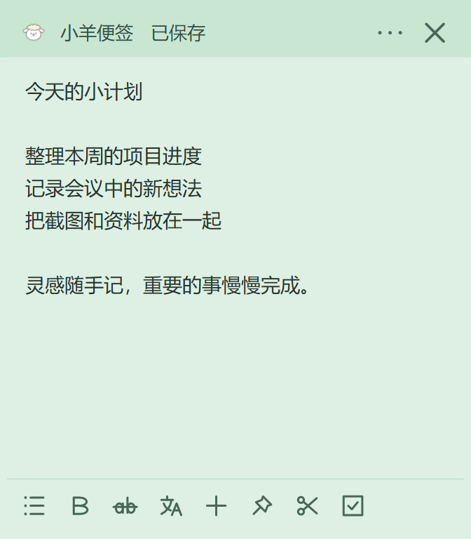
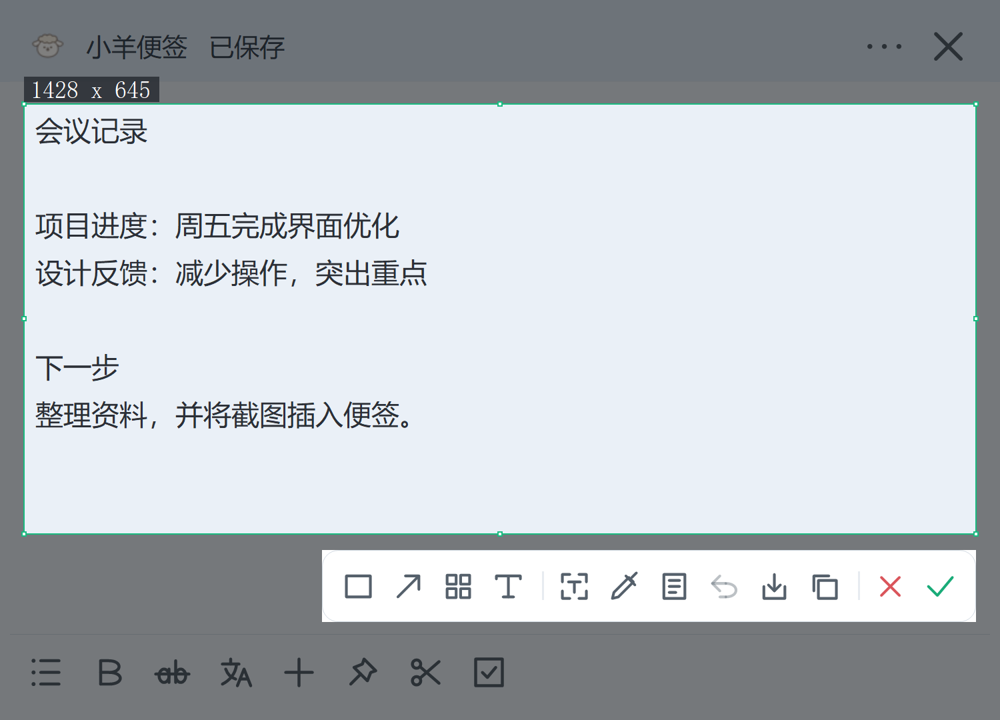

# 小羊便签 WPF

这是小羊便签 Windows 版的 WPF 私有开发仓库，承接后续桌面端开发。起点为原 `KimNotes` WPF 开发分支的桌面专用源码 `f372a44`。WinForms 版继续在公开的 `KimNotes/master` 维护。

[官网](https://note.kimlulu.com/) · [下载 v1.4.24](https://note.kimlulu.com/downloads/KimNotes-v1.4.24.zip) · [GitHub Releases](https://github.com/kimlonger/KimNotes/releases)

| 桌面便签 | 截图与标注 | 待办提醒 |
|:---:|:---:|:---:|
|  |  |  |

## 功能

- **便签**：文字和图片、独立主题、置顶、自动保存与桌面布局记忆。
- **截图与贴图**：框选、标注、OCR、贴图，支持将截图插入便签和回看最近贴图。
- **待办**：支持每天、工作日和每周循环提醒。
- **云同步**：登录后自动同步便签和图片，新电脑登录后可下载；离线时先保存本机。
- **网页端**：查看、搜索和编辑普通便签，桌面富文本便签可查看。

## 开始使用

支持 Windows 10 / 11，需要 .NET Framework 4.8。下载后完整解压，运行 `KimNotes.exe`；升级前请先从托盘退出旧版。

- 截图：`Ctrl + F1`
- 唤回最近贴图：`Ctrl + F2`
- 上一张 / 下一张贴图：`Ctrl + ←` / `Ctrl + →`

快捷键可在设置中修改。关闭所有便签后，程序仍在系统托盘运行。

便签和待办可离线使用，登录为可选。登录后可同步待办并在网页版查看；贴图历史保存在本机；OCR 和翻译通过百度服务联网处理相应图片或文字。

## 开发与反馈

本仓维护 WPF 客户端源码、测试和打包。当前桌面版使用 C#、WPF 和 .NET Framework 4.8，官网与共享 API 通过 HTTPS 为客户端提供服务。构建、数据备份及测试方法见 [开发与数据维护](docs/development.md)。

[LINUX DO 社区](https://linux.do) · [Apache License 2.0](LICENSE)
